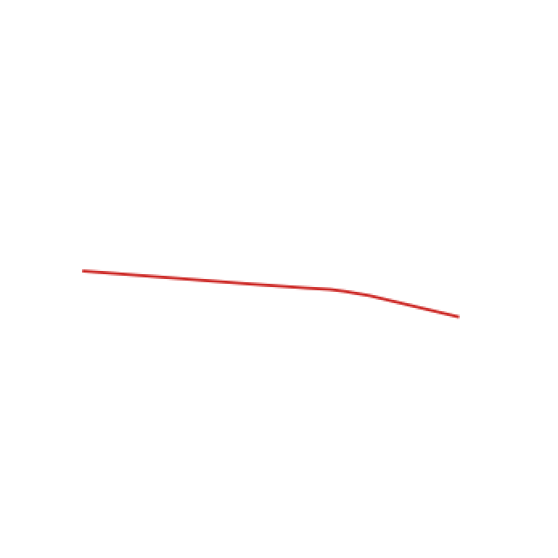

TL;DR: We will learn how to construct multiple non-overlapping buffers around `linetstring` objects using `PostGIS` in `PostgreSQL`.

<!--  -->


<!-- <div style="width:300; font-size:80%; text-align:center;">Linestring</div> -->
<!-- <figure>
    
    <figcaption>Caption goes here</figcaption>
</figure> -->
<!-- 
  -->


## Requirements
Ensure that you have Postgresql installed on your computer, we will use the terminal for this post but you can also install the `pgadmin` interface  if you prefer a GUI. You can see installation instructions for postgresql [here](http://www.postgresqltutorial.com/install-postgresql/) and download `pgadmin` [here](https://www.pgadmin.org/download/). 

If installed correctly, you can initialize and then start the postgres database as follows:

```console
sirchidi:~$ initdb /usr/local/var/postgres -E utf8
sirchidi:~$ pg_ctl -D /usr/local/var/postgres -l /usr/local/var/postgres/server.log start
```

After the second command, you should see something like this:
```console
sirchidi:~$ waiting for server to start....done
server started
```

You can also check the status of the server using

```console
sirchidi:~$ pg_ctl -D /usr/local/var/postgres status
```
If it is unable to start server, you can do 

```console
sirchidi:~$ killall postgres
```
to kill any old processes that may be interfering and then retry the above commands.

```console
sirchidi:~$ whoami
```

For this post, we will be using a very small `.csv` file containing the coordinates of six streets, and can be downloaded from  [here](https://chidubemiddianozie.com/files/sample_data.csv).

Okay, all set, lets begin.

## Methods
We can split this section into three sub-sections
* Reading from file
    * We have to ensure that the files are read correctly into a postgresql table and persisted correctly. Every operation will be done on this table.
* Buffer Construction
    * This is where we reason about to perform the construction of the multiple buffers.
* Writing to file
    * Finally, we write the constructed buffers from the postgresql table back to a file.

### Reading from file
To read the file and persist to a table in the `postgres` database, we can switch to the postgresql terminal as follows:

```console
sirchidi:~$ psql -d postgres
```
This let's us use the postgres database.

Then, we create a table `streetSample` with three columns to correspond with the number of columns in our `.csv` file.

~~~~sql
CREATE TABLE streetSample(
street text,
osmid text,
geom text);
~~~~

Next, we need to create a `postgis` extension for the database and a spatial index for the new table 

~~~~sql
CREATE EXTENSION postgis;
CREATE INDEX streetSample_index 
    ON streetSample 
    USING gist (geom);
~~~~

Now, we copy the file from local to the table thus:

~~~~sql
COPY streetSample (street, osmid, geom) 
FROM '/path/to/file/on/local/streetSample.csv'  DELIMITER ',' CSV HEADER;
~~~~

Finally, to finish up this sub-section, we have to set the crs code and column type for the geom object to 4326 which is the crs for lat-long coordinates.

~~~~sql
ALTER TABLE streetSample 
    ALTER COLUMN geom 
    TYPE geometry 
    USING ST_SetSRID ((geom::geometry),4326);
~~~~

### Buffer Construction

We will now construct three buffers, the first buffer will have a radius of 20 metres, the second one will be of 100 metres and the last one will be of 200 metres.

But first, we create three columns in the table for the buffers.
~~~~sql
ALTER TABLE streetSample  ADD COLUMN buffer_20_metres geometry (Geometry, 4326);
ALTER TABLE streetSample  ADD COLUMN buffer_100_metres geometry (Geometry, 4326);
ALTER TABLE streetSample  ADD COLUMN buffer_200_metres geometry (Geometry, 4326);
~~~~

Then, we update the new columns using the constructed buffers. 

~~~~sql
UPDATE streetSample  SET buffer_20_metres = ST_Transform(ST_Buffer(ST_Transform(geom,3857), 20,  'endcap=round join=round'),4326);

UPDATE streetSample 
    SET buffer_100_metres =  
        ST_Transform(
            ST_Difference(
                ST_Buffer(ST_Transform(geom,3857), 100,  'endcap=round join=round'),
                ST_Buffer(ST_Transform(geom,3857), 20,  'endcap=round join=round')),
                4326);

UPDATE streetSample 
    SET buffer_200_metres =  
        ST_Transform(
            ST_Difference(
                ST_Buffer(ST_Transform(geom,3857), 200,  'endcap=round join=round'),
                ST_Buffer(ST_Transform(geom,3857), 100,  'endcap=round join=round')),
                4326);
~~~~

Notice how we transform between two crs's, that is because the 4326 does not support the metres unit we need to define the buffer radius. Thus, we temporarily transform the linestring coordinates to a metre-crs for the buffer creation in each sql statement and transform back to the working crs.
Another thing to bear in mind is the option for the buffer construction `endcap=round join=round`. This option can also be changed by referring to the postgis documentation [here](https://postgis.net/docs/ST_Buffer.html).

Now, we show a visualization of the buffers:





And, all buffers superimposed on the linestring. 


<!-- 


 -->

Our buffers are created and we have to write back to file.


### Writing to file
We write the updated table to `.csv` using:
~~~~sql
COPY
    (
    select 
        street, 
        osmid, 
        ST_AsText(geom) AS geom, 
        ST_AsText(buffer_20_metres) AS buffer_20_metres,
        ST_AsText(buffer_100_metres) AS buffer_100_metres,
        ST_AsText(buffer_200_metres) AS buffer_200_metres
    from streetSample
    )
TO '/path/to/file/streetSample_with_buffers.csv' DELIMITER ',' CSV HEADER;
~~~~

## Final words

I hope this helps someone, the `SQL` code for this post is available [here](https://github.com/sirchidi/concentricBufferConstruction). If you have any queries, please leave a comment below or open an issue on in the [code repo](https://github.com/sirchidi/concentricBufferConstruction). Thanks!